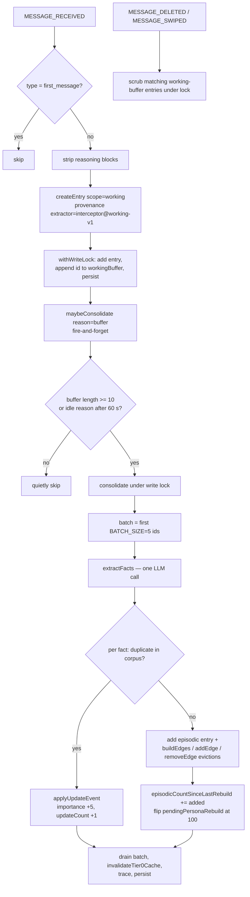

# Architecture

How STARmem v2 is actually put together: the three design principles as the code enforces them, the module layering, the boot sequence, and the two lifecycles (write path and retrieval path) with their real control flow. Companion pages: [data-model.md](./data-model.md) for persisted shapes, [retrieval.md](./retrieval.md) and [consolidation.md](./consolidation.md) for the deep dives.

Source: `index.js`, `manifest.json`, `src/integration/bootstrap.js`, `src/integration/interceptor.js`, `src/integration/constants.js`, `src/consolidation/consolidate.js`, `src/consolidation/triggers.js`, `src/retrieval/ladder.js`, `src/core/state.js`, `src/core/schema.js`, `tests/unit/consolidation/no-other-mutators.test.js`.

## Principles as enforced

### 1. Deterministic retrieval—no LLM, no embeddings on the query path

The retrieval call chain—`globalThis.STARmemInterceptor` → `starmemInterceptor()` → `retrieve()` → tiers—imports nothing that can call a model or a vector store. The interceptor's imports are integration constants, the retrieval barrel, state I/O, the lock, and the macro helper (`src/integration/interceptor.js:37-50`); the ladder's imports are constants, lifecycle helpers, and its own tier modules (`src/retrieval/ladder.js:10-20`). No LLM client exists anywhere in `src/retrieval/`.

**Divergence** (spec and older docs oversimplify): embeddings *are* used by the system—`src/consolidation/raptor/embeddings.js` is a real client for SillyTavern's Vectors HTTP API, consumed by Persona rebuild's k-NN step. The accurate statement is "the retrieval query path is embedding-free and LLM-free; the Persona rebuild path uses ST Vectors + LLM summarization." See the [drift register](./drift-register.md).

### 2. One path per responsibility—enforced per-concern, with a tripwire

The literal spec phrasing "single mutator" is enforced **per concern**, not as one function:

- Long-term storage (`state.entries`, `state.graph`) is mutated by `consolidate()` (`src/consolidation/consolidate.js:74`) and by `atomicReplacePersona()` on the Persona rebuild path (`src/consolidation/raptor/atomic.js`). Both run inside `withWriteLock`.
- Working-buffer state is mutated by the bootstrap event handlers `onMessageReceived` / `onMessageDeleted` / `onMessageSwiped` (`src/integration/bootstrap.js:237-245`, `264-299`, `325-366`), also under `withWriteLock`.
- Traces and tier caches have their own narrow mutators: `logTrace` (`src/retrieval/trace.js:44`), `recordTier0`/`recordTier1`, `clearTraces` (`src/consolidation/triggers.js:119`).

The real rule is encoded in the whitelist of `tests/unit/consolidation/no-other-mutators.test.js:38-57`, which greps `src/` for mutation call sites outside the consolidation module, graph primitives (`src/memory/graph.js`, `src/memory/edgeBuilder.js`), state I/O, the tier-cache/trace helpers, `src/retrieval/ladder.js` (access-event bumps), and `src/lifecycle/importance.js`. The test is a heuristic tripwire, not proof (its own header says so, `tests/unit/consolidation/no-other-mutators.test.js:7-9`).

What is literally single: one extraction function (`extractFacts`, `src/consolidation/extractFacts.js`), one consolidation entry (`consolidate`, `src/consolidation/consolidate.js`), one retrieval entry (`retrieve`, `src/retrieval/ladder.js:139`), and one write lock per chat (`withWriteLock`, `src/core/lock.js`). Persona rebuild is **never automatic**—`consolidate()` only flips the `pendingPersonaRebuild` flag (drift #9, below); `rebuildPersona()` has exactly one production caller, the viewer's Persona tab (`src/integration/viewer/tabs/persona.js:10`).

### 3. Honest instrumentation

Every `retrieve()` call builds exactly one trace and appends it via `logTrace` in every return branch—Tier 0, Tier 1, Tier 3, and Floor all construct a trace before returning (`src/retrieval/ladder.js:151-167`, `176-192`, `222-241`, `111-127`). Consolidation logs one trace per run, including parse-failure runs (`src/consolidation/consolidate.js:166-189`, `271-284`). Traces live in `state.runtime.traces`, a ring buffer capped at `TRACE_BUFFER_CAP = 128` (`src/core/constants.js:162`, `src/retrieval/trace.js:44-56`)—**Divergence**: the spec says 100. Export as JSONL is available from the Memory Viewer's Traces tab.

## Module map and dependency layering

| Layer | Modules | Role |
| --- | --- | --- |
| Entry | `index.js` | Registers the interceptor global; subscribes APP_READY; mounts indicator, settings panel, viewer button. |
| Integration | `src/integration/` (`interceptor.js`, `bootstrap.js`, `settings.js`, `settingsPanel.js`, `indicator.js`, `macro.js`, `constants.js`, `viewer/`) | ST-facing surface: event wiring, injection, settings, UI. |
| Retrieval | `src/retrieval/` (`ladder.js`, `classifier.js`, `scorer.js`, `tier0-exact.js`, `tier1-fuzzy.js`, `tier2-bm25.js`, `tier3-graph.js`, `floor.js`, `bm25.js`, `workingBuffer.js`, `trace.js`) | Query path. Pure functions over `State`; the ladder owns state transitions. |
| Consolidation | `src/consolidation/` (`triggers.js`, `consolidate.js`, `extractFacts.js`, `llmClient.js`, `dedup.js`) and `src/consolidation/raptor/` (`chunking.js`, `knn.js`, `leiden.js`, `summarize.js`, `atomic.js`, `embeddings.js`, `personaRebuild.js`) | Write path. The only layer allowed to mutate long-term storage. |
| Memory | `src/memory/` (`entry.js`, `graph.js`, `edgeBuilder.js`) | Entry construction and graph primitives, called from consolidation (and the working-buffer hook). |
| Lifecycle | `src/lifecycle/` (`recency.js`, `importance.js`, `maturity.js`) | Score math shared by retrieval and consolidation. |
| Core | `src/core/` (`constants.js`, `schema.js`, `state.js`, `lock.js`, `logger.js`) | Persistence, types, tunables, locking, logging. |
| Vendor | `src/vendor/sha256.js` | Deterministic entry ids. |

Direction is downward only: integration imports retrieval/consolidation/core; consolidation imports memory, lifecycle, core, and two retrieval helpers (`invalidateTier0Cache`, `logTrace`—`src/consolidation/consolidate.js:37-43`); retrieval imports lifecycle (recency, maturity, `applyAccessEvent`) and core; memory imports core and vendor. **Consolidation and retrieval do not import `src/integration/`.** Settings cross the boundary by value: `bootstrap.js` builds a `ConsolidateOptions` object from persisted settings and passes it as a parameter (`src/integration/bootstrap.js:67-75`), which `consolidate()` consumes as opaque fields (`src/consolidation/consolidate.js:57-63`).

## State substrate

The whole persisted tree lives in SillyTavern's chat metadata: **`chatMetadata['STARmem'][chatId]` → State** (`src/core/state.js:5-10`).

- The canonical backend is built once at bootstrap: `setBackend(buildStateBackend())` (`src/integration/bootstrap.js:382`, backend body at `98-127`). `read` resolves `ctx.chatMetadata['STARmem'][id]`; `write` creates the `STARmem` slot with `Object.create(null)` if missing (prototype-pollution hardening, `bootstrap.js:116-120`), assigns, then calls `ctx.saveMetadataDebounced()` when available.
- ST swaps the active `chatMetadata` object on chat switch, so the backend resolves it on every read/write instead of caching a reference (`src/core/state.js:8-11`).
- `chatId` is the lock key (`src/core/lock.js`) and a log discriminator—not a storage key; the backend reads whatever is current (`src/core/state.js:12-14`).
- Chat ids are validated against reserved keys before any backend call (`assertSafeChatId`, `src/integration/bootstrap.js:84-91`).
- Before bootstrap, the default backend throws on every call (`src/core/state.js:40-50`)—"bootstrap must run first" is an enforced invariant, not a comment.

## Boot sequence

`manifest.json` points ST at the two globals: `js: "index.js"` and `generate_interceptor: "STARmemInterceptor"` (`manifest.json:6-7`), with `loading_order: 100` (`manifest.json:3`) so the settings panel lands in the right-hand extensions column.

1. ST evaluates `index.js` as a module. `globalThis.STARmemInterceptor` is registered immediately, wrapping the real interceptor in a catch-all so a memory failure cannot break generation (`index.js:41-47`).
2. Still at module eval, if `SillyTavern.getContext` is available, the code subscribes `eventSource.on(event_types.APP_READY, ...)`; otherwise it logs and defers (`index.js:59-118`).
3. On **APP_READY** (`index.js:65-114`), in order:
   1. `bootstrap()`—event subscriptions, state backend, scorer, macro (`index.js:67`).
   2. `mountIndicator()`—the consolidation dot in `#send_form`, resolving the chat id lazily per tick (`index.js:75-78`).
   3. Settings panel—a container under `#extensions_settings2` (fallback `#extensions_settings`) is created and `renderSettingsPanel()` renders into it; the panel's "Open Memory Viewer" button calls `openViewer(chatId)` (`index.js:88-109`).

`bootstrap()` itself (`src/integration/bootstrap.js:374-434`) is idempotent—it tears down prior subscriptions before re-subscribing—and does, in order:

1. `setBackend(buildStateBackend())` (`bootstrap.js:382`).
2. `getSettings()` (fills and re-persists defaults on first call) then `setScorer(settings.scorerId)` (`bootstrap.js:385-388`).
3. `registerStarmemMacro()`—fire-and-forget, idempotent (`bootstrap.js:393-394`).
4. Seeds `lastChatId` from `ctx.chatId` (`bootstrap.js:397`).
5. Subscribes the **five chat-lifecycle events** (`bootstrap.js:410-416`), snake_case ST `event_types`:

| Event | Handler | Behavior |
| --- | --- | --- |
| `CHAT_CHANGED` | `onChatChanged` | Cancels the old chat's idle timer, fires an opportunistic `'buffer'` `maybeConsolidate` for it, updates `lastChatId` (`bootstrap.js:135-148`). |
| `MESSAGE_SENT` | `onMessageSent` | Restarts the 60 s idle timer—user activity (`bootstrap.js:157-164`). |
| `MESSAGE_RECEIVED` | `onMessageReceived` | Creates one `scope: 'working'` entry per assistant reply, appends its id to `workingBuffer`, then fire-and-forget `maybeConsolidate` (`bootstrap.js:180-254`). |
| `MESSAGE_DELETED` | `onMessageDeleted` | Under the lock, drops buffered entries whose `provenance.sourceMessages` includes the deleted message id (`bootstrap.js:264-299`). |
| `MESSAGE_SWIPED` | `onMessageSwiped` | Restarts the idle timer; under the lock, drops only `scope === 'working'` entries referencing the swiped message id—already-consolidated entries survive (`bootstrap.js:325-366`). |

`onMessageReceived` skips ST's `first_message` replay (the character greeting is card lore, not generated content, and would re-add on every load—`bootstrap.js:180-185`) and strips inline reasoning/CoT blocks via `ctx.parseReasoningFromString` when present (`bootstrap.js:199-224`). The working entry's provenance is `{ sourceMessages: [idx], extractor: 'interceptor@working-v1' }` (`bootstrap.js:227-235`).

## Write path



Trigger rules (`src/consolidation/triggers.js:42-66`): `'buffer'` fires only when `workingBuffer.length ≥ CONSOLIDATION.WORKING_BUFFER_THRESHOLD` (10, `src/core/constants.js:112`); `'idle'` fires when the 60-second idle timer elapses (`IDLE_TRIGGER_SECONDS = 60`, `src/core/constants.js:114`, timer at `triggers.js:75-90`) and only requires a non-empty buffer. Both gates are pre-checks; `consolidate()` re-checks under the lock. **Divergence**: the settings panel's `bufferSize` / `idleTimeout` sliders are inert—no runtime code reads them; the live thresholds are the hardcoded constants above. See the [drift register](./drift-register.md).

Inside `consolidate()` (`src/consolidation/consolidate.js:74-288`): stale `consolidating` flag is cleared and skipped, not retried (`:100-105`); the batch is captured before any mutation (`:112-130`); parse failures from the extractor drain the batch and persist a trace with `summary.error: 'parse_failure'` instead of aborting (`:160-191`); transport/unknown errors abort with no mutation and an intact buffer (`:193-202`); on success the batch is drained, the Tier 0 exact cache is invalidated once per batch, and state persists—all inside the lock (`:256-287`).

## Retrieval path

```mermaid
flowchart TD
    A[ST calls STARmemInterceptor] --> B{injection mode}
    B -- off --> C[clear prompt slot + macro body,<br/>skip retrieval]
    B -- automatic / macro --> D[extract last user query]
    D --> E[withWriteLock: loadState]
    E --> F[retrieve state, query, cause=generation type]
    F --> G{Tier 0 exact cache hit?}
    G -- yes --> H[tierResolved=0]
    G -- no --> I{Tier 1 Jaccard >= 0.6?}
    I -- yes --> J[tierResolved=1, backfill Tier 0 cache]
    I -- no --> K[Tier 2 BM25+ — seed provider only]
    K --> L{scored non-empty?}
    L -- no --> M[Floor: recency-ranked, tierResolved=floor]
    L -- yes --> N[Tier 3: beam over graph,<br/>seeds = top 3 of Tier 2]
    N --> O{expansion empty?}
    O -- yes --> M
    O -- no --> P[tierResolved=3,<br/>backfill Tier 0 + Tier 1 caches]
    H --> Q[prepend working buffer at score=Infinity,<br/>applyAccessEvent per returned entry,<br/>append trace to ring cap 128]
    J --> Q
    M --> Q
    P --> Q
    Q --> R[persist state inside the lock]
    R --> S{mode}
    S -- automatic --> T[setExtensionPrompt<br/>IN_CHAT depth 4 SYSTEM]
    S -- macro --> U[cached for {{starmem-memories}},<br/>prompt slot cleared]
```

Details that matter:

- `retrieve(state, queryStr, opts)`—signature `opts = { now?: Date, k = 5, cause?: string }` (`src/retrieval/ladder.js:139-141`). The generation type arrives as `cause` (`'normal'` when absent—`src/integration/interceptor.js:251`).
- The ladder composes: classifier (`classify`, `src/retrieval/classifier.js:40`) → Tier 0 exact cache (`src/retrieval/tier0-exact.js:63`) → Tier 1 Jaccard fuzzy (`src/retrieval/tier1-fuzzy.js:61`) → Tier 2 BM25+ (`src/retrieval/tier2-bm25.js:40`) → Tier 3 graph beam (`src/retrieval/tier3-graph.js`) → Floor recency ranking (`src/retrieval/floor.js`). Working-buffer entries are prepended to every tier's result via `prependWorking` (`src/retrieval/ladder.js:150,175,221,107`).
- **Tier 2 is a seed provider, not a resolver**: `tier2()` returns `{ scored }` only—there is no `hit` (`src/retrieval/tier2-bm25.js:31,40`), and the ladder uses its top `TIER3_SEEDS_K = 3` entries purely to seed Tier 3 (`src/retrieval/ladder.js:196-206`). `tierResolved` is never `2` (values produced: `0`, `1`, `3`, `'floor'`); a legacy persisted `2` is rendered as `T3` in the viewer's trace badges (`src/integration/viewer/tabs/traces.js:107`). **Divergence** vs spec §5; see the [drift register](./drift-register.md).
- The interceptor loads, retrieves, and persists under one `withWriteLock` so a concurrent consolidation commit cannot be overwritten by a stale snapshot (`src/integration/interceptor.js:252-259`).
- Injection: automatic mode registers the memory body through ST's `setExtensionPrompt` under the stable key `INJECTION_PROMPT_KEY = 'STARmem'`, defaulting to IN_CHAT (position 1), depth 4, SYSTEM role (`src/integration/constants.js:19,27,35,41`; `src/integration/interceptor.js:154-169,278-281`)—position/depth/role are settings-configurable. Macro mode caches the headerless body for `{{starmem-memories}}` and clears the prompt slot so the surfaces never stack (`interceptor.js:268-276`). Mode `off` clears both and skips retrieval (`interceptor.js:225-230`).
- All interceptor errors are swallowed and the previous injection is cleared, so stale memories cannot leak into the next turn (`index.js:44-46`, `interceptor.js:287-297`).

## Runtime wiring status of lifecycle machinery

Importance events run: `applyAccessEvent` (+3) fires per returned entry inside the ladder (`src/retrieval/ladder.js:69-84`) and `applyUpdateEvent` (+5) inside consolidation's dedup-update path (`src/consolidation/consolidate.js:217`). **Unwired**: daily decay (`applyDailyDecay`, `src/lifecycle/importance.js:73`) and maturity transitions (`maturityFor`, `src/lifecycle/maturity.js:31`) have no production callers—entries stay `maturity: 'draft'` and `importance` moves but tier never changes. **Divergence** #4; details in the [drift register](./drift-register.md).

Persona rebuild is triggered only from the Memory Viewer's Persona tab (`src/integration/viewer/tabs/persona.js:10`); `consolidate()` merely sets `runtime.pendingPersonaRebuild` once `episodicCountSinceLastRebuild` reaches 100 (`src/consolidation/consolidate.js:241-253`). **Divergence** #9.

## See also

- [data-model.md](./data-model.md)—the persisted shapes everything above reads and writes.
- [drift-register.md](./drift-register.md)—the canonical spec-vs-code divergence list cited throughout.
- [core.md](./core.md), [retrieval.md](./retrieval.md), [consolidation.md](./consolidation.md), [integration.md](./integration.md)—planned per-concern deep dives.
- `docs/specs/2026-04-20-starmem-v2-design.md`—the approved design-of-record (not code truth).
