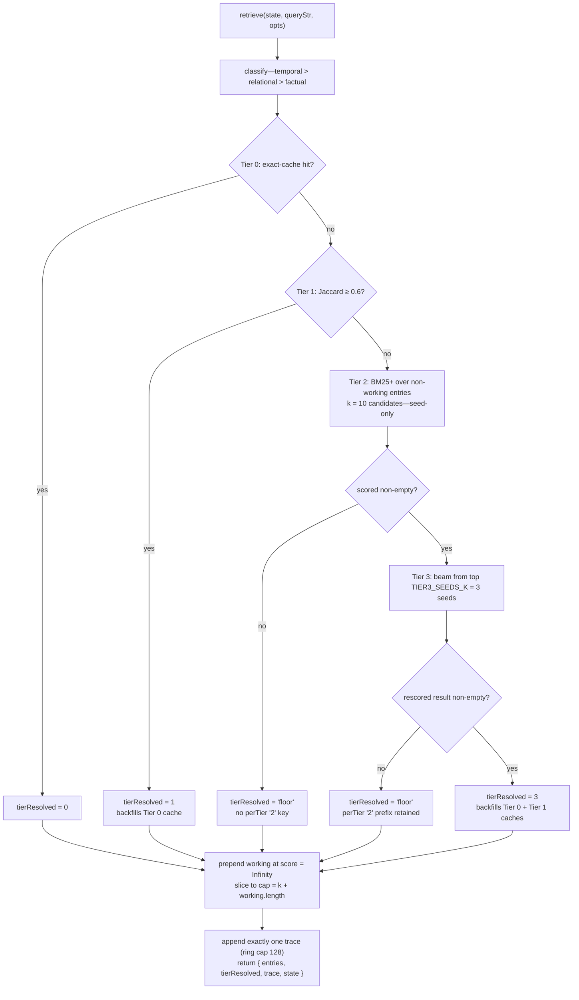

# Retrieval

The deterministic query path: how `retrieve()` turns `(state, last user query)` into a ranked entry list plus a replayable trace, with no LLM and no embedding call anywhere in the branch tree. The ladder is a fixed cascade—exact cache → Jaccard fuzzy cache → BM25+ candidate generation → graph beam expansion → recency floor—with the working buffer prepended to every result. **Tier 2 is a seed provider, not a resolver**: `tierResolved` is only ever `0`, `1`, `3`, or `'floor'`, never `2` (drift #1; see the Tier 2 section below and the [drift register](./drift-register.md)).

Source: `src/retrieval/ladder.js`, `classifier.js`, `tier0-exact.js`, `tier1-fuzzy.js`, `tier2-bm25.js`, `tier3-graph.js`, `floor.js`, `scorer.js`, `bm25.js`, `workingBuffer.js`, `trace.js`, `index.js` (barrel), plus `src/memory/graph.js` (adjacency) and `src/core/constants.js` (all constants cited). Behavior confirmed against `tests/integration/retrieval/ladder.test.js`.

## Entry point and contract

`retrieve(state, queryStr, opts = {})` with `opts = { now?, k, cause? }`—`now` defaults to `new Date()`, `k` to **5** (`src/retrieval/ladder.js:139-141`). It is pure over its input: every branch derives a new state (access-event bumps, trace appended) and returns `{ entries, tierResolved, trace, state }` (`ladder.js:29-36`). The production caller is the interceptor: `retrieve(state, query, { now: new Date(), cause })`—it never passes `k`, so production always runs at the default 5 (`src/integration/interceptor.js:254`), inside the same `withWriteLock` as `loadState`/`persistState` (`interceptor.js:252-259`). `cause` is the ST generation type, `'normal'` when missing or empty (`interceptor.js:251`). The ladder never persists; persistence is the caller's job, and even a zero-entry result carries a trace, which is why the interceptor persists `result.state` unconditionally (`interceptor.js:249-257`).

Per call, before any tier: the query is classified (`ladder.js:141`), the active scorer id is read as a trace label (`ladder.js:142`), `state.workingBuffer` ids are dereferenced to entries, skipping missing ids (`workingEntriesOf`, `ladder.js:43-50`), and the result cap is computed as `cap = k + working.length` (`ladder.js:144`).

## Branch tree



Every branch constructs exactly one trace and returns through the same post-processing: working entries first, then the tier's entries, sliced to `cap` (`ladder.js:150-167`, `175-192`, `221-241`, `107-127`).

## Classifier

`classify(query)` (`src/retrieval/classifier.js:40-53`) is a pure regex cascade with fixed priority **temporal > relational > factual**: the first matching temporal pattern wins, then relational, else the query is `factual`. A blank query classifies as `factual` (`classifier.js:44`); a non-string argument throws (`classifier.js:41-43`).

| Intent | Cue patterns | Site |
| --- | --- | --- |
| `temporal` | `\bwhen\b`; `before/after/during/recently/yesterday/today`; `last week/month/year/time`; a four-digit year `19|20|21\d{2}`; `\bago\b` | `classifier.js:13-19` |
| `relational` | `\bwho\b`; `with whom`; `together`; `related`; `connection`; `between X and Y`; `relate(s/d)`; two capitalized tokens joined by `and`/`&`/`,` | `classifier.js:21-31` |
| `factual` | default—no temporal or relational cue | `classifier.js:52` |

The intent feeds two consumers: the Tier 3 beam's edge-type weighting (`EDGE_TYPE_WEIGHTS[edge.type][intent]`, `src/retrieval/tier3-graph.js:72-73`) and the trace's `classifier` field. It is passed to `tier2()` but **not consumed there** (`tier2-bm25.js:41-43`).

## Tier 0—exact cache

Cache key: `hashQuery(normalizeQuery(q))` (`src/retrieval/tier0-exact.js:52-54`). `normalizeQuery` is `trim().toLowerCase()` with internal whitespace preserved (`tier0-exact.js:28-33`); `hashQuery` is a hand-rolled **FNV-1a 32-bit** hash rendered as 8-char lowercase hex, seeded `0x811c9dc5` and multiplied by `0x01000193` via `Math.imul` (`tier0-exact.js:42-49`). Not cryptographic—collision-safe enough for a per-chat cache, per its own docstring.

- **Hit**: `tier0()` looks up `state.tierCaches.exact[key]`; a hit dereferences the cached id list, skipping ids whose entries no longer exist (`tier0-exact.js:63-75`). A missing or *empty* cached list is a miss (`tier0-exact.js:66-68`).
- **Recording**: `recordTier0()` stores the resolved id list under the key, delete-then-reinsert so an updated key moves to the end of the object's insertion order (`tier0-exact.js:91-112`). The cap is `RETRIEVAL.TIER_CACHE_MAX_ENTRIES = 200` (`src/core/constants.js:78`), read at call time so benchmark sweep overrides are observed (`tier0-exact.js:82-84`). Excess keys are evicted oldest-insertion-first. Note this is insertion-order eviction: a plain `tier0()` hit does not refresh the key's position—only re-recording does.
- **Invalidation**: `invalidateTier0Cache()` replaces the whole exact map with `{}` (`tier0-exact.js:122-130`). It is called once at the end of every consolidation batch, inside the write lock (`src/consolidation/consolidate.js:259`)—new episodic entries would otherwise be invisible to repeated exact queries. Working-buffer appends do **not** invalidate it; the prepend runs downstream of the cache by design (`tier0-exact.js:3-5`).
- The fuzzy cache has no bulk invalidation at all (nothing in `src/retrieval/` exports one)—see [Boundary notes](#boundary-notes).

## Tier 1—Jaccard fuzzy

Second chance for near-duplicate queries without re-running BM25. Key: `tokenSetKey(query)`—the query's unique tokens (via the BM25 tokenizer) sorted and joined by single spaces (`src/retrieval/tier1-fuzzy.js:40-43`).

- `tier1()` tokenizes the query, then scans every cached token-set key, computing `jaccard(qTokens, cachedTokens)`—set semantics, both-empty → 0 (`tier1-fuzzy.js:23-31`). The highest-scoring cached list wins; it is a hit only if the best Jaccard ≥ `RETRIEVAL.FUZZY_JACCARD_THRESHOLD` = **0.6** (`tier1-fuzzy.js:80`; `src/core/constants.js:61`).
- Recording: `recordTier1()` mirrors Tier 0's LRU-at-200 eviction (`tier1-fuzzy.js:102-123`); an empty token set is a no-op (`tier1-fuzzy.js:104-106`).
- **Backfill direction**: a Tier 1 hit is recorded into the Tier 0 exact cache on the way out (`ladder.js:173`), so the exact same query next time short-circuits at Tier 0. A Tier 3 resolution backfills both caches (`ladder.js:218-219`). Floor results backfill neither.

## Tier 2—BM25+ candidate provider (seed-only)

`tier2(state, queryStr, { now, intent, k = 10, diagnostic? })` builds a fresh BM25+ index over **all non-working entries** and returns the top candidates rescored under the default scorer's formula (`src/retrieval/tier2-bm25.js:40-99`). The ladder calls it with `k: 10` (`ladder.js:201`), so at most 10 candidates are scored per query.

- **Return shape is `{ scored }`—there is no `hit` field** (`tier2-bm25.js:31`, typedef `Tier2Result`). An empty pool, zero BM25 matches, or all-zero rescores each return `{ scored: [] }` (`tier2-bm25.js:51-59`, `94-96`). `TIER2_TAU_CONFIDENCE` / `TIER2_TAU_GAP` no longer exist in `src/core/constants.js`; they were removed in Phase 14 along with the resolver role.
- The ladder uses `t2.scored` in exactly two ways: the top `RETRIEVAL.TIER3_SEEDS_K` = **3** entries become Tier 3's seeds (`ladder.js:204-205`; `src/core/constants.js:80`), and the full scored list is recorded into `trace.perTier['2']` (`ladder.js:211`, `228`). When `t2.scored` is empty the ladder goes straight to Floor (`ladder.js:244-246`).
- **`tierResolved` is never `2`.** The ladder produces only `0` (`ladder.js:155`), `1` (`ladder.js:180`), `3` (`ladder.js:226`), and `'floor'` (`ladder.js:115`); the demolition invariant is pinned by `tests/integration/retrieval/ladder.test.js:135-150`. The `Trace` typedef still admits `2` (plus the bench-only `'bm25only' | 'recency' | 'random'` labels) for backward compatibility (`src/retrieval/trace.js:17`), and a legacy persisted `tierResolved: 2` renders as **`T3`** in the viewer's trace badges—`2 || 3 → 'T3'` (`src/integration/viewer/tabs/traces.js:107`).
- **Scorer wiring (drift #8)**: the rescore is *inlined*—the registry is deliberately bypassed (`tier2-bm25.js:61-66`):

  ```text
  score = bm25 × (1 + importance/100) × recencyAt(now, createdAt) × maturityBoost(maturity)
  ```

  identical to the default scorer (`src/retrieval/scorer.js:41-49`; factors cited at `tier2-bm25.js:69-73`). `getScorerId()` still labels traces, so a registered alternate scorer would be *labeled* in traces but would not change Tier 2's ranking. A `diagnostic: true` ctx adds a `factors` breakdown (`bm25`, `importance`, `importanceFactor`, `recencyFactor`, `maturityFactor`—`tier2-bm25.js:80-88`); the ladder never passes it.

## BM25+ scoring module

Shared by Tier 2 and Tier 3 (`src/retrieval/bm25.js`), hand-rolled, in-memory only, rebuilt per call.

**Tokenization** (`bm25.js:22-28`): lowercase, split on `/[^a-z0-9]+/u`, keep tokens ≥ 2 chars. Query tokens are deduplicated (`bm25.js:94`).

**Document construction** (`buildIndex`, `bm25.js:44-83`): each non-working entry's document is `content` tokens plus subject tokens **replicated ×2** (`RETRIEVAL.SUBJECT_BOOST = 2`) and tag tokens **replicated ×2** (`TAG_BOOST = 2`) (`bm25.js:60-64`; `src/core/constants.js:74-76`). Document length includes the replicated tokens; a document-frequency map and average document length are computed over the pool.

**Scoring** (`bm25.js:99-110`): per document, per query term with `tf > 0`:

```text
idf   = ln(1 + (N − df + 0.5) / (df + 0.5))
norm  = 1 − b + b · (len / avgLen)
term  = idf · tf · (k1 + 1) / (tf + k1 · norm) + δ
```

with `BM25_K1 = 1.2`, `BM25_B = 0.75`, `BM25_DELTA = 1.0` (`src/core/constants.js:68-72`). Note the code's exact shape: δ is added per matching term and is **not** idf-weighted. Documents with no term overlap score 0 and are dropped; results sort descending, optionally sliced to `k` (`bm25.js:109-113`).

## Tier 3—MAGMA-lite graph beam

`tier3(state, seeds, queryStr, intent, { now, k = 5 })` (`src/retrieval/tier3-graph.js:31-101`)—beam search 1–2 hops from Tier 2's seeds through `state.graph.edges`, then a full rescore.

**Setup** (`tier3-graph.js:35-49`): adjacency is rebuilt per call from the flat edge list, forward direction only—`buildAdjacency` buckets edges by `from`, so expansion follows `from → to` (`src/memory/graph.js:80-92`); adjacency is never persisted. A BM25 map is built over all non-working entries with `k = max(nonWorking.length, 1)`—effectively uncapped—and `bm25Of(id)` defaults to 0 for entries with no term overlap.

**Beam walk** (`tier3-graph.js:51-89`): seeds start in `discovered` at hop 0. For `hop = 1..RETRIEVAL.TIER3_MAX_HOPS` (**2**, `src/core/constants.js:66`): every neighbor of the frontier that is not yet discovered, exists in `state.entries` (via an `Object.hasOwn` guard against reserved keys—defensive against edges predating the extractFacts guard, `tier3-graph.js:66-68`), and is not `working`-scope (`tier3-graph.js:71`) is scored:

```text
beamScore = exp(λ₁ · edgeWeight + λ₂ · bm25)
```

with `TIER3_LAMBDA_1 = 1.0`, `TIER3_LAMBDA_2 = 0.3` (`tier3-graph.js:75`; `src/core/constants.js:63-64`), where `edgeWeight = EDGE_TYPE_WEIGHTS[edge.type][intent]`, falling back to 0 for an unknown edge type or unmapped intent (`tier3-graph.js:72-73`). Candidates are sorted by beamScore and the top `TIER3_BEAM_WIDTH` = **5** per hop become both the discovered set additions and the next frontier (`tier3-graph.js:80-87`; `src/core/constants.js:82`). The loop ends when a hop yields no candidates or the frontier empties.

**Edge-type × intent weights** (`src/core/constants.js:96-102`)—the beam routing table:

| Edge type | factual | relational | temporal |
| --- | --- | --- | --- |
| `supports` | 0.9 | 0.5 | 0.3 |
| `mentions` | 0.7 | 0.9 | 0.3 |
| `same_topic` | 0.5 | 0.8 | 0.5 |
| `temporal_next` | 0.3 | 0.4 | 0.9 |
| `contradicts` | 0.2 | 0.3 | 0.2 |

The `contradicts` row is dormant—v2.0's edge builder never emits that type (`src/core/constants.js:13-16`).

**Final rescore** (`tier3-graph.js:91-100`): every discovered entry—seeds *and* beam expansions—is rescored through `getScorer()` (`tier3-graph.js:91,96`), i.e. the multiplicative default scorer `bm25 × (1 + importance/100) × recencyAt(now, createdAt) × maturityBoost(maturity)` (`src/retrieval/scorer.js:41-49`, with a `bm25 === 0` fast path returning 0 at `scorer.js:43`). Results sort by rescored score, filter `score > 0`, and slice to `k` (`tier3-graph.js:99-100`). An empty result—the `score > 0` filter can empty even a non-empty discovery set when the scorer returns 0 for everything—falls through to Floor with the Tier 2 prefix retained in the trace (`ladder.js:209-213`).

## Floor

Pure fallback when every tier above produced nothing (`src/retrieval/floor.js:18-34`), and the Tier 3 fall-through target. All non-working entries with a well-formed lifecycle (`importance` numeric, `createdAt` string—malformed ones are skipped, `floor.js:22-26`) are scored:

```text
score = recencyAt(now, createdAt) × (1 + importance/100) × maturityBoost(maturity)
```

(`floor.js:27-29`). No BM25 factor; `bm25` is reported as 0 in result tuples (`floor.js:31`). Non-finite scores are dropped (`floor.js:30`); results sort descending and slice to `k` (`floor.js:33-34`). `recencyAt` is `exp(−Δt_days / 30)` and `maturityBoost` is draft 0.85 / validated 1.0 / core 1.2—see [lifecycle.md](./lifecycle.md). In v2.0 the applied maturity boost is always the draft value 0.85, because `maturityFor` never runs (drift #4).

A fresh chat resolves here: an empty state returns `tierResolved: 'floor'` with `entries: []` and a `factual` trace (`ladder.test.js:30-36`), and the floor also fires when BM25 cannot match a query at all (`ladder.test.js:38-43`).

## Working-buffer prepend

`prependWorking(results, workingEntries, _now)` (`src/retrieval/workingBuffer.js:30-46`) runs in **every** return branch (`ladder.js:150`, `175`, `221`, `107`). Working entries are prepended as `{ bm25: 0, score: Infinity }`—a sentinel that outranks any scored tier output without letting lifecycle factors touch their ranking (`workingBuffer.js:2-7`). The incoming results are filtered to drop entries whose ids already appear in the working buffer, keeping the working copy as the freshest view (`workingBuffer.js:38-45`). `_now` is reserved and unused (`workingBuffer.js:27`).

Ordering consequence: the returned `entries` array starts with every surviving working-buffer entry in buffer order, then the tier's entries. Tier 0/1 entries are wrapped with `bm25 = 0, score = 0` before prepending (`wrapZero`, `ladder.js:58-60`); Tier 2/3 and floor results carry their real scores. The final `.slice(0, cap)` with `cap = k + working.length` (`ladder.js:144`, applied at `ladder.js:163`, `188`, `237`) trims from the tail, so working entries always survive; it is material only for Tier 0/1, whose cached id lists can exceed `k`. The floor branch omits the slice (`ladder.js:123`) because floor itself returns at most `k` entries, making the total bounded by `cap` anyway.

## Access events

`applyAccessEventsToReturned` (`ladder.js:69-84`) applies one `applyAccessEvent` (+3 importance, `accessCount + 1`) per entry the tier resolved—**only returned entries**: not working-buffer entries, not the rest of the corpus (`tests/integration/retrieval/ladder.test.js:100-117`, `207-223`). Pure: clones `state.entries`, swaps in the updated copies, returns both state and entries.

One asymmetry worth knowing: in the Tier 0 and Tier 1 branches the returned array holds the *post-bump* entry objects (`final.entries` is what gets prepended, `ladder.js:150`, `175`), while in the Tier 3 and floor branches the returned array holds the *pre-bump* objects (`topK` / `floorResults` are prepended unchanged, `ladder.js:221`, `107`)—the bumped copies live in the returned `state` either way. Consumers that read lifecycle off `state.entries` see the bump in all branches.

## Trace

Exactly one trace per `retrieve()` call, appended via `logTrace` in every branch (`ladder.js:161`, `186`, `235`, `121`). `logTrace` pushes onto `state.runtime.traces` and evicts oldest beyond **`TRACE_BUFFER_CAP = 128`** (`src/retrieval/trace.js:44-56`; `src/core/constants.js:162`)—a ring-buffer cap the spec puts at 100 (drift #6).

Shape (`trace.js:13-23`):

| Field | Notes |
| --- | --- |
| `timestamp` | ISO string of the call's `now`. |
| `query` | The raw query string, verbatim. |
| `classifier` | `'factual' \| 'relational' \| 'temporal'`. |
| `tierResolved` | `0 \| 1 \| 3 \| 'floor'` in practice; the typedef admits `2` (legacy) and the bench labels `'bm25only' \| 'recency' \| 'random'`, which current ladder code never emits. |
| `perTier` | Tier 0: `{ '0': [{ id }] }` (`ladder.js:156`). Tier 1: `{ '1': [{ id }] }` (`ladder.js:181`). Tier 3: `{ '2': [{ id, bm25, score }], '3': [{ id, bm25, score }] }`—separate arrays, not a copy (`ladder.js:227-230`; pinned at `ladder.test.js:190-205`). Floor after non-empty Tier 2: `{ '2': [{ id, bm25, score }] }` only (`ladder.js:110`, `211`); plain floor has an empty `perTier` (`ladder.js:109`). |
| `finalRanking` | Entry ids after the working prepend, pre-slice. |
| `scorerId` | Label from `getScorerId()` (`ladder.js:142`)—`'default'` in every production run (`scorer.js:55`). |
| `cause` | Optional generation type, spread in only when the caller supplied one (`ladder.js:159`, `184`, `233`, `119`). |

## Scorer registry (wiring status)

The registry (`src/retrieval/scorer.js`) holds exactly `'default'` at module load (`scorer.js:52-55`). `registerScorer(id, fn)` rejects collisions (`scorer.js:73-75`) and `setScorer(id)` throws on unknown ids (`scorer.js:85-90`); re-registering the literal `defaultScorer` under `'default'` is a no-op (`scorer.js:72`). In production the registry is never extended: **drift #8**—Tier 3 consults `getScorer()` (`tier3-graph.js:91`) but Tier 2 hardcodes the same formula inline (`tier2-bm25.js:61-66`), and the settings panel's `getAvailableScorerIds()` hardcodes `['default']` (`src/integration/settingsPanel.js:70-72`) because no listing API exists yet. Alternate scorers are registered only by tests (`tests/integration/retrieval/ladder.test.js:46-47` and throughout)—the bench harness never registers or sets a scorer (`bench/runner.js:22` imports only `getScorerId`).

## Boundary notes

- **Stale caches degrade, they do not crash.** A cached id list whose entries were all deleted still registers as a hit with an empty entry array: Tier 0 checks the *raw* list length before dereferencing (`tier0-exact.js:66-68`) and skips missing ids afterwards (`:70-73`); Tier 1 keeps `bestIds` non-null even when every dereference fails (`tier1-fuzzy.js:80-89`). The exact map is the only one with a bulk invalidation (`consolidate.js:259`); the fuzzy map can hold stale keys indefinitely.
- **Latency budgets are spec, not code.** The tier docstrings state design targets ("hit returns in <1ms", "<5ms: O(cacheSize × avgTokens)", `tier0-exact.js:3-4`, `tier1-fuzzy.js:3-4`), but no timing is measured or enforced anywhere in `src/retrieval/`.
- **Swept constants.** `TIER3_LAMBDA_1/2`, `TIER3_MAX_HOPS`, `TIER3_SEEDS_K`, `TIER3_BEAM_WIDTH`, `TIER_CACHE_MAX_ENTRIES`, `SUBJECT_BOOST`, `TAG_BOOST`, `EDGE_CAP_PER_ENTRY`, and the two relation weights are sweep-overridable via `setConstantOverrides` (`src/core/constants.js:189-201`); call sites read them at call time rather than destructuring at module top (`tier0-exact.js:82-84`). Values above are the module-load defaults.
- **Determinism.** The whole path is a pure function of `(state, query, now)` plus the registered scorer—no RNG, no clock reads beyond the injected `now`, no network. Identical inputs produce identical `entries` orderings and identical traces.

## See also

- [architecture.md](./architecture.md)—the retrieval path inside the full interceptor flow, with its own Mermaid diagram.
- [data-model.md](./data-model.md)—the `tierCaches`, `Trace`, and `Runtime.traces` shapes the ladder reads and writes.
- [lifecycle.md](./lifecycle.md)—`recencyAt`, `maturityBoost`, and the access-event transform the ladder applies.
- [consolidation.md](./consolidation.md)—the write path that invalidates Tier 0 and produces the graph edges Tier 3 walks.
- [drift-register.md](./drift-register.md)—Tier-2-demolition (#1) and scorer-partial-pluggability (#8) entries.
